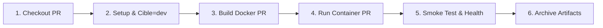

# 📋 Guide de Workflow des Pull Requests (PR) — Biwex Store

> **Auteur :** Abdoul TRAORE ([@a21traore06-creator](https://github.com/a21traore06-creator))  
> **Branche de travail :** `feature/abdoul-traore`  
> **Projet :** DevOps 3LIG — ISG Sousse  

---

## 🎯 Objectif du Workflow PR

Pour respecter la consigne de gestion stricte des branches imposée par l'enseignante :
1. La branche **`main`** est strictement protégée (aucun push direct autorisé).
2. La branche **`dev`** est la branche d'intégration principale.
3. Chaque développeur développe sur sa branche personnelle :
   - `feature/famory-toure` pour **Famory TOURE**
   - `feature/abdoul-traore` pour **Abdoul TRAORE**
4. Toute modification doit obligatoirement être soumise sous la forme d'une **Pull Request vers `dev`**.

---

## 🚦 Fonctionnement du Pipeline 1 (`Jenkinsfile-PR`)

Dès l'ouverture ou la mise à jour d'une Pull Request ciblant `dev`, Jenkins déclenche automatiquement le pipeline de validation :



### Critères d'acceptation de la PR :
- **Target branch :** Doit impérativement être `dev`.
- **Build Docker :** L'image `biwex-store:pr-<BUILD_NUMBER>` doit compiler sans erreur.
- **Smoke Test :** Le test HTTP doit retourner le statut **`PASSED`** (Code 200).
- **Review :** Au moins une approbation du binôme avec droits d'écriture.

---

## 📦 Commandes de base pour le binôme

### 1. Créer sa branche de fonctionnalité :
```bash
git checkout dev
git pull origin dev
git checkout -b feature/abdoul-traore
```

### 2. Committer avec signature claire :
```bash
git add .
git commit -m "feat(module): description claire de la fonctionnalite"
git push -u origin feature/abdoul-traore
```

### 3. Ouvrir la Pull Request sur GitHub :
Rendez-vous sur l'interface GitHub du projet :
- **Base :** `dev`
- **Compare :** `feature/abdoul-traore`
- Titre : `[PR] Intégration des fonctionnalités par Abdoul Traoré`
- Vérifier que le statut du build Jenkins passe au **VERT** avant fusion.
